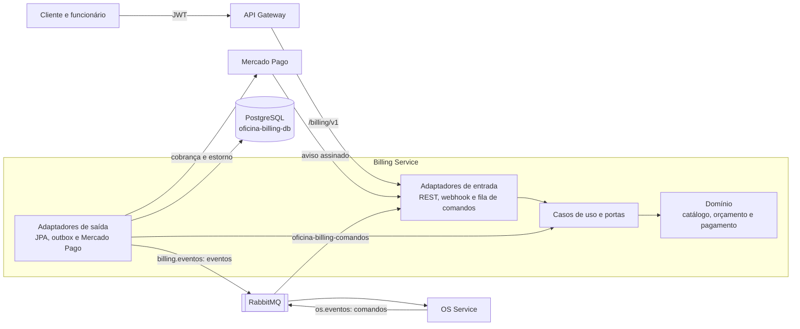
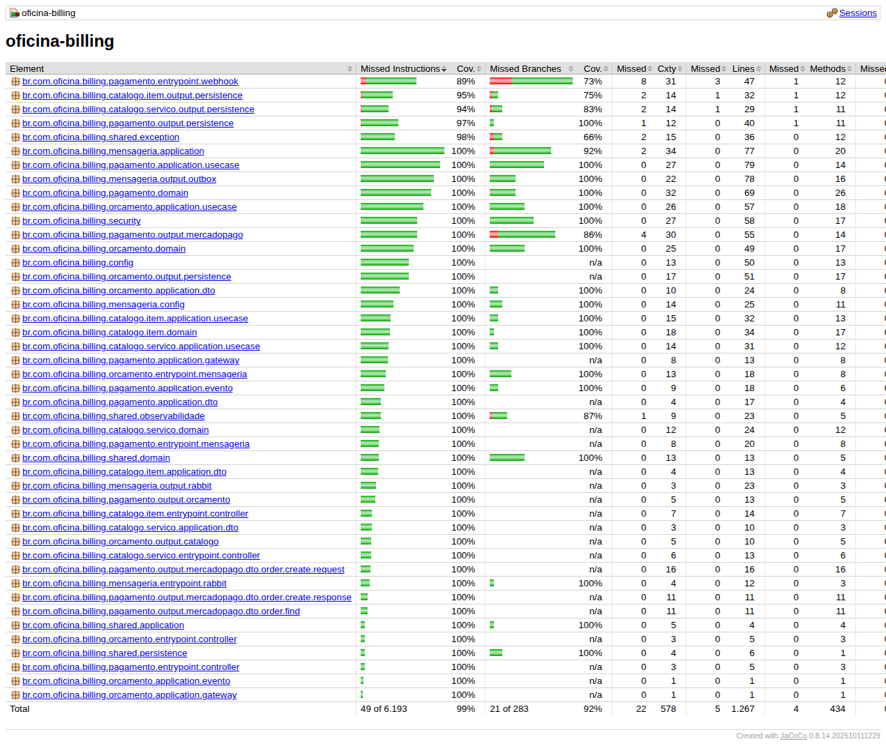
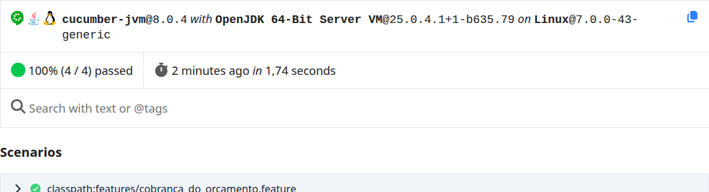

# oficina-billing

Microsserviço de catálogo, orçamento e pagamento da oficina mecânica (Tech Challenge Fase 4, Pós-Tech
em Arquitetura de Software, FIAP). É o dono de tudo que tem valor em reais: catálogo de serviços e
itens com preço, orçamento, pagamento pelo Mercado Pago e estorno. Fala só com o OS Service, por
evento da Saga; não conhece o serviço de Execução.

O que falta e a ordem de implementação estão em [docs/plano-implementacao.md](docs/plano-implementacao.md).
Toda entrega segue [docs/REGRAS_EXECUCAO_E_QUALIDADE.md](docs/REGRAS_EXECUCAO_E_QUALIDADE.md).

## Estado atual

| Etapa | Situação |
| --- | --- |
| 1. Fundação | Feita: segurança, erros, correlação, Swagger, Docker, CI e esteira de qualidade |
| 2. Banco e catálogo | Feita: PostgreSQL com Flyway e catálogo de serviços e itens com preço |
| 3. Orçamento | Feita: geração idempotente por `sagaId` e consulta com posse por cliente |
| 4. Pagamento e Mercado Pago | Feita: cobrança pela Orders API, webhook assinado e estorno |
| 5. Saga e mensageria | Feita: comandos do OS Service pelo RabbitMQ, eventos pelo outbox, DLQ e BDD |
| 6. Deploy e entrega | Feita: manifestos Kubernetes, pipeline com SonarCloud, Trivy e deploy no EKS, proteção da `main` |

## Arquitetura

Clean Architecture / Ports and Adapters, com a regra de dependência verificada por teste
(`ArquiteturaTest`, ArchUnit). Fonte do diagrama: [docs/arquitetura/visao-geral.mmd](docs/arquitetura/visao-geral.mmd).



Cada funcionalidade segue as mesmas camadas: `domain` (Java puro), `application` (casos de uso, um
por classe, e as portas em `gateway`), `entrypoint` (controllers) e `output` (JPA e integrações).

| Pacote | Papel |
| --- | --- |
| `catalogo/servico`, `catalogo/item` | Catálogo com preço: cadastro, atualização, inativação e consulta |
| `orcamento` | Geração do orçamento a partir do pedido do OS Service e consulta |
| `pagamento` | Cobrança, confirmação pelo webhook, estorno e consulta; o Mercado Pago fica em `pagamento/output/mercadopago` |
| `mensageria` | Consumo dos comandos da Saga, outbox e RabbitMQ; os manipuladores de cada comando ficam em `<funcionalidade>/entrypoint/mensageria` |
| `config` | Segurança (`SecurityConfig`) e OpenAPI |
| `security` | Validação do JWT e respostas 401/403 em problem+json |
| `shared` | Erros (`HandlerGeralExcecoes`), correlação de logs (`CorrelationIdFilter`) e regras de valor e texto |

Decisões de arquitetura: [docs/adr](docs/adr).

## Banco de dados

PostgreSQL próprio (`oficina-billing-db`), versionado com Flyway (`src/main/resources/db/migration`):

| Tabela | Conteúdo |
| --- | --- |
| `servico` | Catálogo de serviços com preço (nome único, sem diferenciar maiúsculas) |
| `item` | Peças e insumos com preço de venda (tipo, nome e unidade únicos, sem diferenciar maiúsculas) |
| `orcamento` | Cabeçalho do orçamento: `saga_id` (único), OS, cliente, veículo e os totais |
| `orcamento_servico` | Serviços orçados, com cópia do nome e do preço da época |
| `orcamento_item` | Itens orçados, com quantidade e cópia do nome e do preço da época |
| `pagamento` | Um por orçamento: status, ordem e link do Mercado Pago, estorno e a última resposta do provedor (`jsonb`), com versão otimista |
| `outbox_evento` | Eventos para o OS Service à espera de envio (Transactional Outbox), com `message_id` único |

Valores em `NUMERIC(10,2)`, sempre positivos (`CHECK` no banco). As regras de unicidade também são
índices únicos: dois cadastros iguais ao mesmo tempo resultam em um gravado e um 422, nunca em 500.
OS, cliente e veículo são ids lógicos do OS Service, sem chave estrangeira.

### Mudanças em relação ao monólito

- **Sem estoque.** O saldo, o estoque mínimo e as movimentações foram para o serviço de Execução. O
  Billing fica só com o preço; os dois falam do mesmo item pelo id.
- **Duplicidade de item pelo nome.** O monólito considerava duplicado o mesmo tipo, **descrição** e
  unidade. Como a descrição é opcional, dois itens diferentes sem descrição colidiam. Agora vale o
  mesmo tipo, **nome** e unidade.
- **Inativar não confere OS ativa.** O Billing não conhece o status da OS, e o orçamento guarda uma
  cópia do nome e do preço de cada linha. Inativar só tira o serviço ou item dos orçamentos novos.
- **Ids do catálogo.** O OS Service referencia os ids do catálogo antigo (decisão em aberto no
  `docs/alinhamento-contrato-billing-e-execucao.md` do repositório `oficina-os-service`). Para manter
  os ids na carga, insira as linhas com o `id` explícito e depois ajuste as sequências
  com `SELECT setval('servico_id_seq', (SELECT max(id) FROM servico))` (o mesmo para `item`). Itens
  que repetem tipo, nome e unidade precisam ser resolvidos antes, por causa do índice único.

## Tecnologias

Java 21, Spring Boot 4.1.2, Spring Data JPA, PostgreSQL 15, Flyway, Spring Security com JWT (jjwt),
Spring Cloud OpenFeign, springdoc-openapi, JUnit 5, Mockito, Testcontainers, ArchUnit, JaCoCo,
Spotless, Checkstyle, SpotBugs com FindSecBugs e Trivy.

## Orçamento

O orçamento nasce do pedido do OS Service (`SolicitarOrcamento`, com só ids e quantidades) e é
montado pelo caso de uso `GerarOrcamento` com os preços do catálogo. A entrada pela fila da Saga e a
resposta `OrcamentoGerado` entram na etapa 5; não existe `POST` de orçamento na API, de propósito.

- **Cópia do preço.** Cada linha guarda o nome e o preço do catálogo no momento do orçamento. Mudar o
  catálogo depois não muda orçamento já gerado.
- **Idempotente por `sagaId`.** O mesmo pedido de novo (o OS reenvia até 3 vezes, e a mensagem pode
  chegar repetida) devolve o orçamento já gerado. O `saga_id` é único no banco: duas entregas
  simultâneas gravam um orçamento só, e a que perde a corrida, tentada de novo, recebe o já gerado.
  O mesmo `sagaId` vindo de outra OS é recusado.
- **Catálogo.** Serviço ou item que não existe no catálogo, ou que está inativo, impede o orçamento.
  Pelo contrato com o OS Service não há evento de falha de orçamento: o OS reenvia o pedido e, sem
  resposta, libera a OS para pedir de novo.
- **Totais.** `valorServicos` (um de cada serviço), `valorItens` (preço × quantidade) e `valorTotal`
  saem sempre das linhas.

## Pagamento

Pela Orders API do Mercado Pago, com checkout online
([ADR 0002](docs/adr/0002-pagamento-pela-orders-api-do-mercado-pago.md)):

1. Com o orçamento aprovado, o caso de uso `CobrarPagamento` cria a ordem no Mercado Pago e grava o
   pagamento `AGUARDANDO_PAGAMENTO` com o link do checkout.
2. O cliente pega o link em `GET /pagamentos/orcamento/{orcamentoId}` e paga no Mercado Pago.
3. O Mercado Pago avisa em `POST /pagamentos/webhook/mercadopago`. O Billing confere a assinatura
   `x-signature`, consulta a ordem na API e confirma (`processed`) ou recusa (`failed`, `canceled`,
   `expired`) o pagamento. Aviso repetido não muda nada.
4. Na compensação da Saga, `EstornarPagamento` faz o reembolso total da ordem.

A cobrança e o estorno levam `X-Idempotency-Key` fixa (por orçamento e por pagamento), e há um
pagamento por orçamento no banco: comando repetido não cobra nem estorna duas vezes. As credenciais
vêm do painel do Mercado Pago (`MERCADOPAGO_ACCESS_TOKEN` e `MERCADOPAGO_WEBHOOK_SECRET`), e o webhook
é configurado lá, no tópico "Order". Os testes usam a Orders API simulada (WireMock); falta validar
contra o sandbox com credenciais de teste.

## Saga e mensageria

A Saga é orquestrada pelo OS Service; o Billing atende os comandos e responde por evento, pelo
RabbitMQ ([ADR 0003](docs/adr/0003-saga-pelo-rabbitmq-com-respostas-idempotentes.md), contrato em
[docs/mensageria.md](docs/mensageria.md)):

| Comando do OS Service | Caso de uso | Resposta do Billing |
| --- | --- | --- |
| `SolicitarOrcamento` | `GerarOrcamento` | `OrcamentoGerado` |
| `CobrarPagamento` | `CobrarPagamento` | `PagamentoConfirmado` ou `PagamentoRecusado`, quando o Mercado Pago avisar |
| `EstornarPagamento` | `EstornarPagamento` | `PagamentoEstornado` |

- **Outbox.** O evento é gravado na transação da mudança e enviado depois, com confirmação do broker.
- **Idempotência.** Comando repetido passa pelo caso de uso, que não duplica nada e responde de novo com o
  mesmo `messageId` (determinístico); o OS Service descarta a repetição.
- **Falhas.** Mensagem inválida ou recusada por regra de negócio vai direto para a DLQ
  `oficina-billing-comandos-dlq`. Falha transitória é tentada 3 vezes antes de ir para a DLQ.
- **BDD.** Os cenários em [src/test/resources/features](src/test/resources/features) rodam a Saga pelo
  RabbitMQ real, com o Mercado Pago simulado (relatório em `target/cucumber/relatorio.html`).

## Endpoints

Todos sob `/billing/v1`. Catálogo só para funcionários (`ADMIN` e `ATENDENTE`); orçamento e pagamento
também para o cliente, que vê só os próprios (o de outro cliente responde 404). O webhook é público e
validado pela assinatura.

| Método | Rota | O que faz |
| --- | --- | --- |
| `POST` | `/servicos` | Cadastra serviço |
| `GET` | `/servicos` | Lista serviços, ativos e inativos |
| `GET` | `/servicos/{id}` | Busca serviço |
| `PUT` | `/servicos/{id}` | Atualiza serviço |
| `DELETE` | `/servicos/{id}` | Inativa serviço |
| `POST` | `/itens` | Cadastra item |
| `GET` | `/itens` | Lista itens, ativos e inativos |
| `GET` | `/itens/{id}` | Busca item |
| `GET` | `/itens/tipo/{tipo}` | Lista itens de um tipo (`PECA` ou `INSUMO`) |
| `PUT` | `/itens/{id}` | Atualiza item |
| `DELETE` | `/itens/{id}` | Inativa item |
| `GET` | `/orcamentos/{id}` | Busca orçamento (funcionário ou cliente dono) |
| `GET` | `/orcamentos/ordem-servico/{ordemServicoId}` | Lista os orçamentos da OS, do mais recente para o mais antigo |
| `GET` | `/pagamentos/{id}` | Busca pagamento (funcionário ou cliente dono) |
| `GET` | `/pagamentos/orcamento/{orcamentoId}` | Busca o pagamento do orçamento, com o link do checkout |
| `POST` | `/pagamentos/webhook/mercadopago` | Aviso do Mercado Pago (sem JWT, exige `x-signature`) |

Mudar o preço vale para os orçamentos futuros: orçamento já gerado guarda o valor da época.

## Segurança

Todas as rotas exigem `Authorization: Bearer <token>`, menos o health check e o Swagger. O Billing só
valida o token, com o mesmo segredo da Lambda de autenticação e do OS Service
([ADR 0001](docs/adr/0001-jwt-validado-sem-consulta-ao-banco.md)):

- token de funcionário (`ADMIN` ou `ATENDENTE`), emitido por `POST /oficina/v1/auth/login` no OS Service;
- token de cliente, emitido por `POST /auth/token` na Lambda de autenticação por CPF.

O token de cliente só entra nas consultas de orçamento e de pagamento, e a posse é conferida nos casos
de uso (`ConsultarOrcamentos`, `ConsultarPagamentos`). O webhook do Mercado Pago não usa JWT: aceita só
aviso com assinatura válida, e mesmo assim o status vem de uma consulta à API do Mercado Pago. Sem token válido a resposta é 401; com token sem permissão para a rota, 403.
Os dois em `application/problem+json`, como os demais erros da API.

## Como executar

### Variáveis de ambiente

| Variável | Uso | Default |
| --- | --- | --- |
| `SPRING_DATASOURCE_URL` | JDBC do PostgreSQL do Billing | `jdbc:postgresql://localhost:5433/billing` |
| `SPRING_DATASOURCE_USERNAME` | Usuário do banco | `postgres` |
| `SPRING_DATASOURCE_PASSWORD` | Senha do banco | `postgres` |
| `SPRING_DATASOURCE_POOL_SIZE` | Tamanho máximo do pool de conexões | `5` |
| `SPRING_RABBITMQ_HOST`, `SPRING_RABBITMQ_PORT` | RabbitMQ da Saga, o mesmo do OS Service | `localhost`, `5672` |
| `SPRING_RABBITMQ_USERNAME`, `SPRING_RABBITMQ_PASSWORD` | Credenciais do RabbitMQ | `guest`, `guest` |
| `SECURITY_JWT_SECRET` | Segredo HS256 do JWT, o mesmo da Lambda e do OS Service (mínimo de 32 caracteres) | segredo local de desenvolvimento |
| `MERCADOPAGO_URL` | URL base da API do Mercado Pago | `https://api.mercadopago.com` |
| `MERCADOPAGO_ACCESS_TOKEN` | Access token das credenciais da aplicação no Mercado Pago | vazio (cobrança falha) |
| `MERCADOPAGO_WEBHOOK_SECRET` | Segredo de assinatura do webhook, do painel do Mercado Pago | vazio (todo aviso é recusado) |
| `ENVIRONMENT` | Ambiente nos logs estruturados (perfil `docker`) | `local` |
| `BILLING_PORT` | Porta no host do `docker compose` | `8081` |
| `POSTGRES_DB`, `POSTGRES_USER`, `POSTGRES_PASSWORD` | Banco criado pelo `docker compose` | `billing`, `postgres`, `postgres` |
| `POSTGRES_PORT` | Porta do PostgreSQL no host do `docker compose` | `5433` |
| `RABBITMQ_USER`, `RABBITMQ_PASSWORD` | Credenciais do RabbitMQ criado pelo `docker compose` | `guest`, `guest` |
| `RABBITMQ_PORT`, `RABBITMQ_PAINEL_PORT` | Portas do RabbitMQ e do painel no host do `docker compose` | `5673`, `15673` |

Copie o `.env.example` para `.env` se quiser mudar algum valor. As portas 8081, 5433, 5673 e 15673
deixam o Billing rodar junto com o OS Service, que usa 8080, 5432, 5672 e 15672.

### Com Docker

```bash
docker compose up --build
```

Sobe o PostgreSQL, um RabbitMQ próprio e a aplicação; o Flyway cria as tabelas e o Billing declara a
fila e as exchanges na subida. Para a Saga de ponta a ponta com o OS Service, os dois precisam do mesmo
broker: suba o OS Service primeiro e aponte o Billing para o RabbitMQ dele, com
`SPRING_RABBITMQ_HOST=host.docker.internal` e `SPRING_RABBITMQ_PORT=5672` no `.env`. A API fica em
`http://localhost:8081/billing/v1` e o Swagger em `http://localhost:8081/billing/v1/swagger-ui.html`.

### Pela IDE ou pelo Maven

```bash
docker compose up -d postgres rabbitmq
```

```bash
SPRING_RABBITMQ_PORT=5673 ./mvnw spring-boot:run
```

A API sobe na porta 8080, usando o PostgreSQL (5433) e o RabbitMQ (5673) do `docker compose`.

### Testes

```bash
./mvnw verify
```

Roda os testes unitários, os de integração e os cenários BDD, que sobem PostgreSQL e RabbitMQ reais com
Testcontainers e simulam o Mercado Pago com WireMock (requer Docker), e derruba o build com cobertura de linhas abaixo de 80% (relatório em
`target/site/jacoco/index.html`). Requer Java 21 ou mais novo.

## Qualidade

```bash
scripts/quality.sh
```

Executa testes, cobertura, Spotless, Checkstyle, SpotBugs, Trivy e calcula o Índice de Qualidade do
Código (IQC), conforme [docs/REGRAS_EXECUCAO_E_QUALIDADE.md](docs/REGRAS_EXECUCAO_E_QUALIDADE.md).
Requer Docker. O resultado fica em `target/quality/iqc.md`. O mesmo script roda no pipeline em todo
pull request para a `main`.

### Evidências

Geradas por `scripts/gerar-evidencias.sh` depois do `scripts/quality.sh` da mesma execução (números do
`target/quality/iqc.md`):

| Critério | Resultado |
| --- | --- |
| Testes | 237 testes e 4 cenários BDD, todos aprovados |
| Cobertura de linhas (JaCoCo) | 99,6% (mínimo exigido: 80%) |
| Análise estática, estilo e lint | 0 achados (SpotBugs + FindSecBugs, Spotless, Checkstyle) |
| Segurança (Trivy) | 0 vulnerabilidades HIGH/CRITICAL, 0 segredos, 0 configurações inseguras |
| IQC | 100 / 100 |





## CI/CD e Kubernetes

Pipeline em [.github/workflows/pipeline.yml](.github/workflows/pipeline.yml), decisão em
[ADR 0004](docs/adr/0004-deploy-no-eks-com-o-broker-do-os-service.md):

| Job | Quando | O que faz |
| --- | --- | --- |
| Qualidade | PR e push na `main` | `scripts/quality.sh` e quality gate do SonarCloud |
| Imagem | PR e push na `main` | Build da imagem e Trivy (HIGH/CRITICAL com correção barra) |
| Manifestos | PR e push na `main` | kubeconform nos overlays `eks` e `local` |
| Deploy EKS | Push na `main` (depois do merge) | Imagem no ECR com tag do commit, `scripts/deploy-k8s.sh eks` e smoke test no Load Balancer |

A `main` só aceita PR com Qualidade, Imagem e Manifestos verdes: `scripts/proteger-main.sh`, rodado uma
vez por quem administra o repositório.

Manifestos em `k8s/` (kustomize): `base` (Deployment não root com raiz somente leitura, probes,
`preStop`, Service, ConfigMap e HPA de 1 a 3 réplicas por CPU), `overlays/eks` (namespace `oficina`,
Load Balancer e New Relic) e `overlays/local` (kind, com PostgreSQL e RabbitMQ próprios). No EKS o
RabbitMQ é o do OS Service, que precisa estar implantado antes.

Validação local no kind, com o mesmo script de deploy do pipeline:

```bash
scripts/k8s-local.sh
```

```bash
scripts/k8s-local.sh --remover
```

Secrets do GitHub usados pelo pipeline (nunca versionados):

| Secret | Uso |
| --- | --- |
| `SONAR_TOKEN` | Quality gate do SonarCloud |
| `AWS_ACCESS_KEY_ID`, `AWS_SECRET_ACCESS_KEY`, `AWS_SESSION_TOKEN` | Credenciais do Learner Lab (renovar a cada sessão) |
| `BILLING_DATASOURCE_URL`, `BILLING_DATASOURCE_USERNAME`, `BILLING_DATASOURCE_PASSWORD` | RDS `oficina-billing-db` |
| `SECURITY_JWT_SECRET` | O mesmo segredo da Lambda e do OS Service |
| `RABBITMQ_USERNAME`, `RABBITMQ_PASSWORD` | Credenciais do RabbitMQ do OS Service |
| `MERCADOPAGO_ACCESS_TOKEN`, `MERCADOPAGO_WEBHOOK_SECRET` | Credenciais do Mercado Pago |

Variáveis opcionais do repositório: `AWS_REGION` (`us-east-1`), `EKS_CLUSTER_NAME` (`oficina-eks`),
`SONAR_ORGANIZATION` (`rremiao`) e `SONAR_PROJECT_KEY` (`rremiao_oficina-billing`).

## Documentação da API

- Swagger: `/billing/v1/swagger-ui.html`
- Contrato OpenAPI: `/billing/v1/api-docs`
- Collection do Postman: [docs/postman/oficina-billing.postman_collection.json](docs/postman/oficina-billing.postman_collection.json)

## Entregáveis do Tech Challenge

| Exigência do PDF | Onde está |
| --- | --- |
| Código-fonte | `src/` |
| Dockerfile | [Dockerfile](Dockerfile) e [docker-compose.yml](docker-compose.yml) |
| Pipeline de CI/CD independente, com deploy em Kubernetes | [.github/workflows/pipeline.yml](.github/workflows/pipeline.yml), seção "CI/CD e Kubernetes" |
| Testes unitários e cobertura mínima de 80% | `src/test/`, JaCoCo no `./mvnw verify`, seção "Evidências" |
| Qualidade de código no CI | `scripts/quality.sh` e quality gate do SonarCloud no pipeline |
| Repositório protegido (PR obrigatório) | [scripts/proteger-main.sh](scripts/proteger-main.sh) |
| Documentação da arquitetura | Seção "Arquitetura" deste README e [docs/adr](docs/adr) |
| Swagger e collection do Postman | `/billing/v1/swagger-ui.html` e [docs/postman](docs/postman) |
| Banco de dados próprio (SQL) | PostgreSQL, seção "Banco de dados" deste README |
| Comunicação assíncrona e Saga (orquestrada pelo OS Service) | Seção "Saga e mensageria", [docs/mensageria.md](docs/mensageria.md) e [ADR 0003](docs/adr/0003-saga-pelo-rabbitmq-com-respostas-idempotentes.md) |
| Fluxo testado com BDD | [src/test/resources/features](src/test/resources/features) |
| Integração com o Mercado Pago | Seção "Pagamento" e [ADR 0002](docs/adr/0002-pagamento-pela-orders-api-do-mercado-pago.md) |
| Dockerfile e manifestos Kubernetes | [Dockerfile](Dockerfile) e [k8s](k8s) |
| Monitoramento e observabilidade da Fase 3 | New Relic injetado pelo operator (`k8s/overlays/eks`), logs JSON com `correlationId` |
